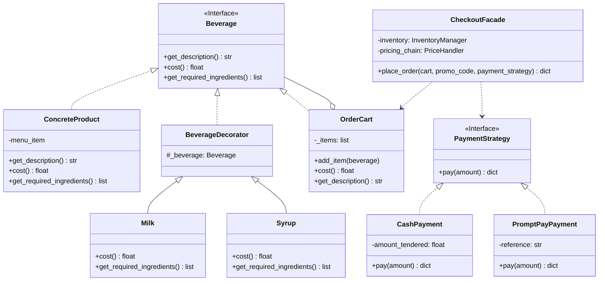
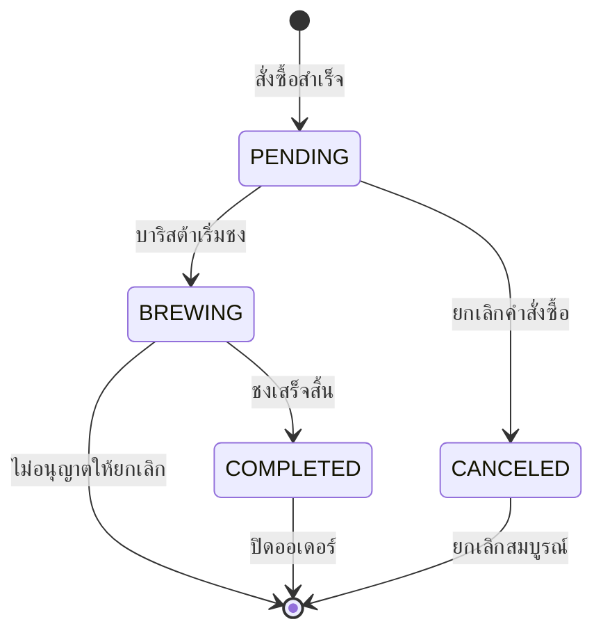
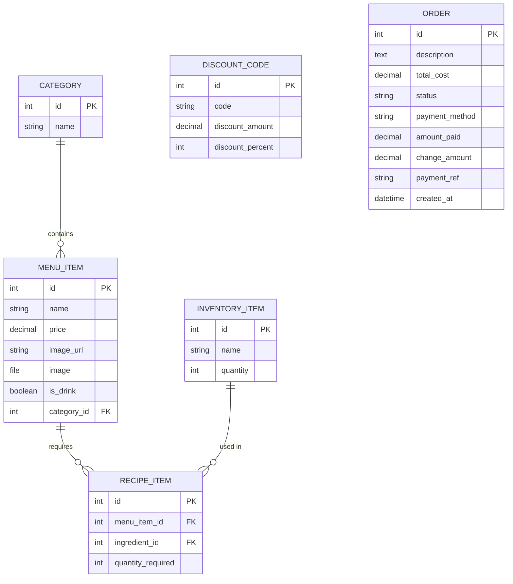

# ☕ CafePOS - Smart Cafe Point of Sale & Kitchen Management System

[](https://www.python.org/)
[](https://www.djangoproject.com/)
[](#)
[](#-software-design-patterns)

> **ระบบบริหารจัดการร้านกาแฟและจุดขายอัจฉริยะ (Smart Cafe POS & KDS)**
> พัฒนาขึ้นด้วยสถาปัตยกรรม **Object-Oriented Design** และนำ **Software Design Patterns** มาประยุกต์ใช้งานจริงอย่างครอบคลุม รองรับตั้งแต่ขั้นตอนการสั่งเครื่องดื่ม, การปรับแต่งท็อปปิ้ง/ระดับความหวาน, ระบบตะกร้าสินค้า, การชำระเงินหลายรูปแบบ, ระบบตัดสต็อกตามสูตร, หน้าจอจัดคิวบาริสต้า (Kitchen Display System), ป้ายแสดงคิวลูกค้าแบบเรียลไทม์ และระบบสรุปยอดขาย

---

## 📌 สารบัญ (Table of Contents)

1. [ภาพรวมระบบ (Overview)](#-ภาพรวมระบบ-overview)
2. [ฟีเจอร์หลัก (Key Features)](#-ฟีเจอร์หลัก-key-features)
3. [สถาปัตยกรรมและการประยุกต์ใช้ Design Patterns](#-สถาปัตยกรรมและการประยุกต์ใช้-design-patterns)
4. [โครงสร้างฐานข้อมูล (Database Schema)](#-โครงสร้างฐานข้อมูล-database-schema)
5. [โครงสร้างโปรเจกต์ (Project Structure)](#-โครงสร้างโปรเจกต์-project-structure)
6. [เส้นทางและหน้าจอการทำงาน (Routes & Pages)](#-เส้นทางและหน้าจอการทำงาน-routes--pages)
7. [วิธีการติดตั้งและรันระบบ (Installation & Getting Started)](#-วิธีการติดตั้งและรันระบบ-installation--getting-started)
8. [เทคโนโลยีที่ใช้ (Tech Stack)](#-เทคโนโลยีที่ใช้-tech-stack)

---

## ☕ ภาพรวมระบบ (Overview)

**CafePOS** เป็นเว็บแอปพลิเคชันที่สร้างขึ้นเพื่อแก้ปัญหาและสนับสนุนการทำงานของร้านกาแฟอย่างครบวงจร:
- **ลูกค้า/แคชเชียร์ (Cashier & Customer):** เลือกดูเมนูตามหมวดหมู่, สั่งกาแฟพร้อมปรับระดับความหวาน, เลือกร้อน/เย็น/ปั่น, เพิ่มนม/ไซรัป, คำนวณส่วนลด และเลือกชำระเงินด้วยเงินสดหรือพร้อมเพย์
- **บาริสต้า (Barista / KDS):** หน้าจอ Kanban สำหรับรับออเดอร์, ดูระยะเวลารอคิว, เลื่อนสถานะ (รอชง ➔ กำลังชง ➔ เสร็จสิ้น) พร้อมระบบป้องกันข้อผิดพลาดในการยกเลิกออเดอร์
- **ป้ายแสดงคิวหน้าร้าน (Customer Live Queue):** แสดงคิวที่กำลังปรุงและคิวที่พร้อมรับแบบอัตโนมัติ (Live Polling)
- **ผู้จัดการร้าน (Store Manager):** จัดการเมนู, ผูกสูตรเมนูเข้ากับวัตถุดิบ (Recipe Builder), จัดการสต็อกวัตถุดิบ, สร้างคูปองส่วนลด และ Export รายงานยอดขายเป็นไฟล์ CSV หรือ Text

---

## 🚀 ฟีเจอร์หลัก (Key Features)

| โมดูล | รายละเอียดฟังก์ชัน |
| :--- | :--- |
| **Menu & Customization** | เมนูแยกหมวดหมู่ รองรับการปรับแต่งระดับความหวาน (0%, 25%, 50%, 100%), อุณหภูมิ (ร้อน/เย็น/ปั่น), ท็อปปิ้งเสริมนม (+15฿) หรือไซรัป (+10฿) |
| **Cart & Multi-Payment** | จัดการตะกร้าสินค้า ปรับจำนวน เพิ่ม/ลด/ลบรายการ, ระบบคูปองส่วนลด, รองรับการชำระเงินสด (คำนวณเงินทอน) และพร้อมเพย์ (สร้างรหัสอ้างอิงอัตโนมัติ) |
| **Inventory & Recipe Link** | ระบบสต็อกสินค้า ตัดสต็อกวัตถุดิบอัตโนมัติเมื่อสั่งซื้อสำเร็จ โดยคำนวณตามสูตรของเมนูนั้นๆ และส่วนผสมที่สั่งเพิ่ม |
| **Barista Kanban (KDS)** | บอร์ดติดตามสถานะออเดอร์แบบเรียลไทม์ แจ้งเตือนเวลาที่ลูกค้ารอคิว พร้อมปุ่มกดเลื่อนสถานะขั้นตอนการชง |
| **Customer Queue Board** | หน้าจอแสดงคิวหน้าร้านแยกฝั่ง "กำลังเตรียม" และ "พร้อมเสิร์ฟ" อัปเดตข้อมูลอัตโนมัติผ่าน REST API Polling |
| **Manager CRUD Suite** | แผงควบคุมสำหรับเพิ่ม/แก้ไข/ลบเมนูและอัปโหลดรูปภาพ, ผูกวัตถุดิบกับสูตร, อัปเดตสต็อก และตั้งค่าโค้ดส่วนลด |
| **Sales Report Export** | ดาวน์โหลดรายงานสรุปยอดขายตามช่วงเวลา รองรับทั้งไฟล์ `.csv` และ `.txt` |

---

## 📐 สถาปัตยกรรมและการประยุกต์ใช้ Design Patterns

โปรเจกต์นี้ได้รับการออกแบบตามหลักการ **Software Design Patterns** จำนวน **8 รูปแบบ** ในส่วนแกนหลัก (`pos/services.py` และ `pos/models.py`):



### 1. Decorator Pattern (การปรับแต่งเครื่องดื่ม)
- **ตำแหน่งโค้ด:** `pos/services.py` (`Beverage`, `ConcreteProduct`, `BeverageDecorator`, `TemperatureDecorator`, `SweetnessDecorator`, `Milk`, `Syrup`)
- **การนำไปใช้:** ใช้ห่อหุ้มเครื่องดื่มพื้นฐานเพื่อต่อเติมคุณสมบัติ เช่น อุณหภูมิ, ระดับความหวาน, และท็อปปิ้งเพิ่มเติมนม/ไซรัป โดยคำนวณราคาเพิ่มและระบุวัตถุดิบที่ต้องใช้เพิ่มโดยไม่ต้องแก้ไขคลาสสินค้าหลัก

### 2. Composite Pattern (ตะกร้าสินค้า)
- **ตำแหน่งโค้ด:** `pos/services.py` (`OrderCart`)
- **การนำไปใช้:** `OrderCart` ทำหน้าที่เป็น Composite ที่สืบทอดมาจาก `Beverage` ทำให้ระบบสามารถมองทั้ง "สินค้าชิ้นเดี่ยว" และ "กลุ่มสินค้าในตะกร้า" เสมือนเป็นวัตถุประเภทเดียวกัน สามารถเรียกคำนวณราคา `cost()`, อ่านรายการคำอธิบาย `get_description()`, และรวบรวมวัตถุดิบทั้งหมด `get_required_ingredients()` ได้ด้วยอินเทอร์เฟซเดียว

### 3. Chain of Responsibility Pattern (การคิดคำนวณราคาและส่วนลด)
- **ตำแหน่งโค้ด:** `pos/services.py` (`PriceHandler`, `CouponHandler`, `VatHandler`)
- **การนำไปใช้:** ส่งผ่านยอดชำระเงินไปตามลำดับโซ่การประมวลผล เริ่มต้นจาก `CouponHandler` (ตรวจสอบและหักส่วนลดทั้งแบบจำนวนเงินคงที่หรือเปอร์เซ็นต์) ไปยัง `VatHandler` (คำนวณภาษีมูลค่าเพิ่ม) ทำให้สามารถเพิ่มกฎการคิดเงินใหม่ๆ ในอนาคตได้อย่างยืดหยุ่น

### 4. Singleton Pattern (ศูนย์กลางตัดสต็อกสินค้า)
- **ตำแหน่งโค้ด:** `pos/services.py` (`InventoryManager`)
- **การนำไปใช้:** ควบคุมให้มี Instance จัดการคลังสินค้าเพียงชุดเดียวตลอดอายุการทำงาน (`__new__`) เพื่อรับประกันความสอดคล้อง (Consistency) ในการตัดสต็อกวัตถุดิบและเรียกดูยอดคงเหลือ

### 5. State Pattern (วงจรสถานะของออเดอร์)
- **ตำแหน่งโค้ด:** `pos/services.py` & `pos/models.py` (`OrderState`, `PendingState`, `BrewingState`, `CompletedState`, `CanceledState`)
- **การนำไปใช้:** จัดการการเปลี่ยนสถานะของคำสั่งซื้อ (`PENDING` ➔ `BREWING` ➔ `COMPLETED`) และควบคุมเงื่อนไขทางธุรกิจ เช่น **ห้ามยกเลิกออเดอร์ที่อยู่ในสถานะกำลังชงหรือเสร็จสิ้นแล้ว** โดยกระจายพฤติกรรมไปยัง State Object ของสถานะนั้นๆ



### 6. Strategy Pattern (กลยุทธ์การชำระเงิน)
- **ตำแหน่งโค้ด:** `pos/services.py` (`PaymentStrategy`, `CashPayment`, `PromptPayPayment`)
- **การนำไปใช้:** แยกอัลกอริทึมการชำระเงินแต่ละประเภทออกจากกัน สามารถสลับรูปแบบการชำระได้ตามที่ผู้ใช้เลือก:
  - `CashPayment`: ตรวจสอบยอดเงินสดที่รับมา คำนวณเงินทอน และแจ้งเตือนเมื่อเงินไม่พอ
  - `PromptPayPayment`: สร้างรหัสอ้างอิงธุรกรรม (Transaction Reference) และบันทึกยอดชำระโดยไม่มีเงินทอน

### 7. Template Method Pattern (โครงสร้างการออกรายงานยอดขาย)
- **ตำแหน่งโค้ด:** `pos/services.py` (`SalesReportTemplate`, `CsvReportGenerator`, `TxtReportGenerator`)
- **การนำไปใช้:** กำหนดโครงร่างขั้นตอนการออกรายงานในคลาสแม่ `generate_report()` (Header ➔ Body ➔ Footer) และเปิดให้คลาสลูกเขียนทับเฉพาะการจัดรูปแบบตัวอักษรของตนเอง เช่น การทำเครื่องหมายคั่นจุลภาคสำหรับ CSV หรือการจัดวรรคหน้าสำหรับ Text File

### 8. Facade Pattern (ศูนย์รวมกระบวนการ Checkout)
- **ตำแหน่งโค้ด:** `pos/services.py` (`CheckoutFacade`)
- **การนำไปใช้:** ซ่อนความซับซ้อนของระบบย่อยเบื้องหลัง (ตะกร้าสินค้า Composite, โซ่คำนวณส่วนลด Chain of Responsibility, การชำระเงิน Strategy, และการตัดสต็อกวัตถุดิบ Singleton) เหลือเพียงคำสั่งเดียวคือ `place_order()` ให้ส่วน Controller/Views เรียกใช้งานได้ง่ายและปลอดภัย

---

## 🗄 โครงสร้างฐานข้อมูล (Database Schema)



---

## 📁 โครงสร้างโปรเจกต์ (Project Structure)

```text
mini-project-SDPv2/
│
├── README.md                      # เอกสารอธิบายรายละเอียดโปรเจกต์
└── cafe_project/
    ├── manage.py                  # สคริปต์คำสั่งจัดการ Django
    ├── pyproject.toml             # ไฟล์การกำหนดค่า UV / Python Dependencies
    ├── uv.lock                    # Dependency lockfile
    ├── db.sqlite3                 # ฐานข้อมูล SQLite
    │
    ├── cafe_project/              # Django Project Settings
    │   ├── __init__.py
    │   ├── settings.py            # การตั้งค่าแอป, สื่อ (Media), ภาษา และเวลา
    │   ├── urls.py                # รูทหลักของระบบ
    │   ├── asgi.py
    │   └── wsgi.py
    │
    ├── pos/                       # Core POS Application
    │   ├── admin.py               # Django Admin configuration
    │   ├── models.py              # Models: Category, MenuItem, RecipeItem, Order ฯลฯ
    │   ├── services.py            # รวมการ Implement Design Patterns ทั้ง 8 รูปแบบ
    │   ├── views.py               # View controllers จัดการหน้าจอและ REST APIs
    │   ├── urls.py                # URL endpoints ของ POS
    │   ├── tests.py               # Test suites
    │   │
    │   └── templates/pos/         # หน้าเว็บ UI (HTML + Tailwind/CSS + JS)
    │       ├── menu.html          # หน้าแสดงเมนูและปรับแต่งสินค้า
    │       ├── cart.html          # หน้าตะกร้าสินค้าและขั้นตอนชำระเงิน
    │       ├── barista.html       # หน้าจอ KDS บาริสต้า (Kanban)
    │       ├── customer_queue.html# หน้าจอแสดงคิวรับเครื่องดื่มแบบเรียลไทม์
    │       ├── inventory.html     # หน้าตรวจสอบสต็อกวัตถุดิบ
    │       └── custom_admin.html  # หน้าแดชบอร์ดจัดการเมนู/สูตร/สต็อก/คูปอง
    │
    ├── media/                     # ไฟล์รูปภาพสินค้าที่อัปโหลด
    │   └── menu_images/
    │
    └── sotfwarepattern/           # สื่อและเอกสารประกอบการศึกษา Design Patterns
```

---

## 🌐 เส้นทางและหน้าจอการทำงาน (Routes & Pages)

| Endpoint | ชื่อหน้า | คำอธิบายการทำงาน |
| :--- | :--- | :--- |
| `/` หรือ `/menu/` | **เมนูสั่งเครื่องดื่ม** | แสดงรายการสินค้าตามหมวดหมู่, ตัวเลือกความหวาน, ร้อน/เย็น/ปั่น และเพิ่มท็อปปิ้ง |
| `/cart/` | **ตะกร้าและการชำระเงิน** | ตรวจสอบยอดรวม, ใส่โค้ดส่วนลด, เลือกชำระเงินสด (พร้อมคำนวณเงินทอน) หรือพร้อมเพย์ QR |
| `/queue/` | **ป้ายคิวลูกค้า** | หน้าจอแสดงคิวแบบอัตโนมัติ (Live Polling ทุก 3 วินาที) แยกคิวเตรียมและคิวพร้อมรับ |
| `/barista/` | **หน้าจอเตาบาริสต้า (KDS)** | บอร์ดคัมบังสำหรับบาริสต้าเพื่อกดรับออเดอร์, ทำการชง, แสดงเวลารอคิว และปิดงาน |
| `/inventory/` | **คลังวัตถุดิบ** | ตรวจสอบปริมาณวัตถุดิบปัจจุบันแบบสังเขป |
| `/manage/` | **ระบบจัดการร้าน (Admin)** | จัดการเมนู, ผูกวัตถุดิบเข้ากับเมนู (สูตร), เพิ่ม/ลดสต็อก, จัดการโปรโมชัน |
| `/export-report/` | **ออกรายงานยอดขาย** | ส่งออกข้อมูลยอดขายทั้งหมด (`?format=csv` หรือ `?format=txt`) |
| `/api/orders/` | **REST API** | ส่งคืนข้อมูล JSON สถานะออเดอร์สำหรับอัปเดตหน้าจอคิวแบบเรียลไทม์ |

---

## 🛠 วิธีการติดตั้งและรันระบบ (Installation & Getting Started)

### 1. ความต้องการเบื้องต้น (Prerequisites)
- **Python 3.12** ขึ้นไป
- แนะนำให้ติดตั้ง [uv](https://docs.astral.sh/uv/) หรือใช้ Python `venv` ปกติ

### 2. การ Clone โปรเจกต์
```bash
git clone https://github.com/saharat784/CafePOS.git
cd mini-project-SDPv2/cafe_project
```

### 3. ติดตั้ง Dependencies และสร้าง Virtual Environment

**ตัวเลือกที่ 1: ติดตั้งผ่าน `uv` (แนะนำ - รวดเร็ว)**
```bash
uv sync
```

**ตัวเลือกที่ 2: ติดตั้งผ่าน `pip` ปกติ**
```bash
python -m venv .venv
# บน Windows
.venv\Scripts\activate
# บน macOS/Linux
source .venv/bin/activate

pip install django>=6.1.1 pillow>=12.3.0
```

### 4. รันการ Migrate ฐานข้อมูล
```bash
python manage.py migrate
```

### 5. สร้างบัญชีผู้ดูแลระบบ (Superuser - สำหรับ Django Admin เพิ่มเติม)
```bash
python manage.py createsuperuser
```

### 6. เริ่มต้นรันเซิร์ฟเวอร์
```bash
python manage.py runserver
```
เข้าใช้งานระบบผ่านเบราว์เซอร์ที่: **`http://127.0.0.1:8000/`**

---

## 💻 เทคโนโลยีที่ใช้ (Tech Stack)

- **Backend:** Python 3.12+, Django 6.1 (MTV Pattern)
- **Frontend:** Django Templates, HTML5, Custom CSS / Tailwind CSS, Modern JavaScript
- **Database:** SQLite3
- **Image Processing:** Pillow (PIL)
- **Package & Environment Management:** uv / pip / pyproject.toml
- **Design Philosophy:** Clean Architecture, SOLID Principles & GoF Design Patterns
